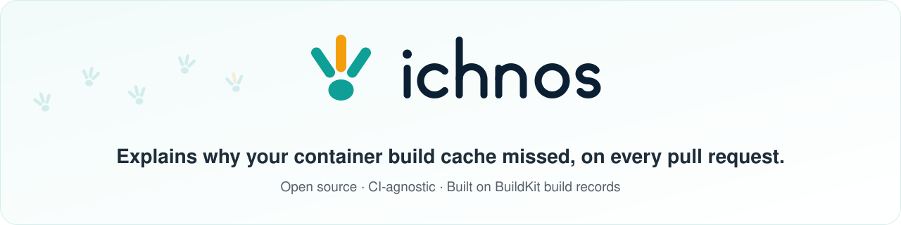

<p align="center">
  <picture>
    <source media="(prefers-color-scheme: dark)" srcset="docs/images/banner-dark.svg">
    
  </picture>
</p>

<p align="center">
  <a href="LICENSE"></a>
  <a href="ROADMAP.md"></a>
  <a href="https://scorecard.dev/viewer/?uri=github.com/ichnos-project/ichnos"></a>
</p>

# Ichnos

Ichnos is a command-line tool and CI integration that explains why a container build missed its cache. It compares a pull request's BuildKit build with the latest build of its base branch, finds the first step that missed the cache, and names what changed: the instruction, a build argument, the base image, or the files the pull request changed. It also checks the cache setup and reports how many minutes each miss costs.

> [!IMPORTANT]
> Ichnos is in early design, and nothing is released yet. See the [roadmap](ROADMAP.md).

## Why Ichnos?

- Docker's build summary and hosted builders report cache hit rates and timings, but not why a step missed the cache. Build systems such as Gradle Develocity and BuildBuddy explain cache misses by comparing two builds; Ichnos brings that to container builds.
- Ichnos uses the pull request's diff to name the changed files behind a `COPY` miss, after `.dockerignore` for a local build context. BuildKit applies no `.dockerignore` to a Git context.
- Every explanation lists the evidence behind it and a confidence level. When the evidence is not enough, Ichnos reports "unknown" rather than guessing.
- Ichnos needs no changes to your build. It reads the build records BuildKit already keeps, which `docker/build-push-action` uploads by default.
- Ichnos is safe on pull requests from forks: the job that comments never runs pull request code, and the jobs that run pull request code never get a write token.

## Getting Started

Ichnos is not released yet. The planned setup is described in:

- [Using Ichnos with GitHub Actions](docs/github-actions.md)
- [Cache setup audit rules](docs/audit-rules.md)
- [What a snapshot holds](docs/snapshot.md)

The planned command-line interface:

```console
$ ichnos compare main.dockerbuild pr.dockerbuild
```

## How It Works

Ichnos reads the build record BuildKit keeps for every build and removes secrets from it. It matches each step with the same step in the base branch's build, by its Dockerfile instruction, and finds the first step that missed the cache without being explained by the pull request's own changes. It then checks the cache setup against rules that fire only on evidence, and reports the result as a pull request comment, JSON, SARIF or OpenTelemetry data. By default it never fails a build.

An example of the planned pull request comment:

> ### Docker build: 6 of 14 steps re-ran (main: all 14 cached) · about +3m 12s
>
> | Step | Dockerfile | main | this PR | Time |
> |---|---|---|---|---|
> | 9 `COPY . .` | line 12 | cached | **ran** | +0.4s |
> | 10 `RUN npm ci` | line 13 | cached | **ran** | +2m 41s |
> | 4 more steps re-ran because step 9 changed | | | | +31s |
>
> **First miss: step 9 `COPY . .`** (expected): `src/server.ts` changed in this pull request.<br>
> **What it cost:** every later step re-ran, including `RUN npm ci` (2m 41s), which does not read `src/`.<br>
> **Suggestion:** copy `package.json` and `package-lock.json` and run `npm ci` before `COPY . .`.

## Roadmap

The [roadmap](ROADMAP.md) lists the planned releases, from an offline compare in v0.1 to stable configuration and report schemas in v1.0. Changes are recorded in the [changelog](CHANGELOG.md), and the release process is described in [RELEASES.md](RELEASES.md).

## Community

- Ask questions and share ideas in [GitHub Discussions](https://github.com/ichnos-project/ichnos/discussions).
- Report bugs and request features in [GitHub Issues](https://github.com/ichnos-project/ichnos/issues).
- The project is run as described in [GOVERNANCE.md](GOVERNANCE.md); the maintainers are listed in [MAINTAINERS.md](MAINTAINERS.md).
- If you use Ichnos, please add your organization to [ADOPTERS.md](ADOPTERS.md).

## Contributing

Our project welcomes contributions from any member of our community. To get started contributing, please see our [Contributor Guide](CONTRIBUTING.md).

## Security

To report a vulnerability, please follow our [Security Policy](SECURITY.md). Do not open a public issue.

## License

This project is licensed under the [Apache License 2.0](LICENSE).

## Code of Conduct

We follow the [CNCF Code of Conduct](CODE_OF_CONDUCT.md).
